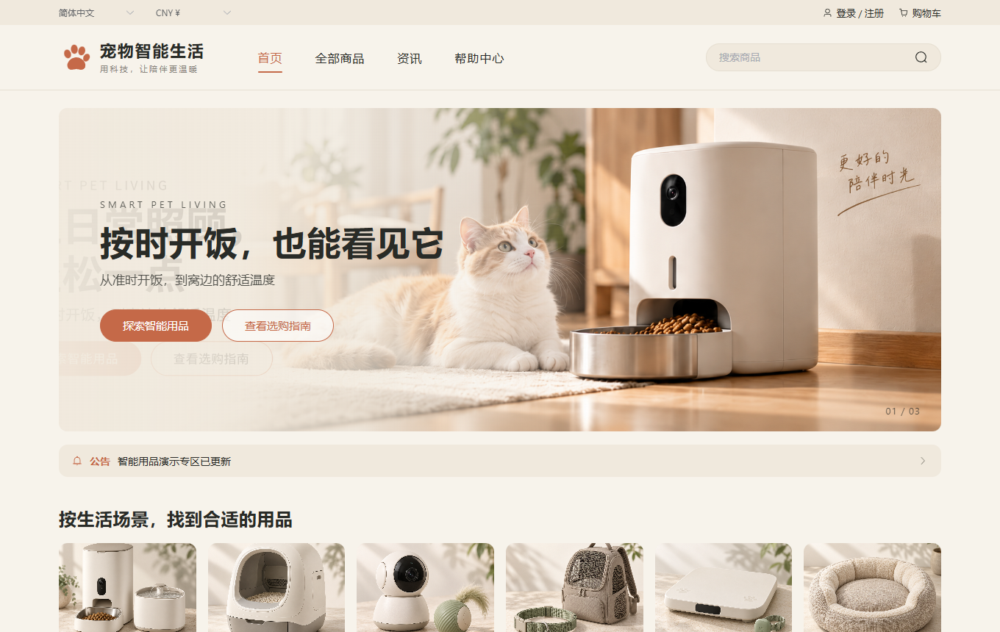
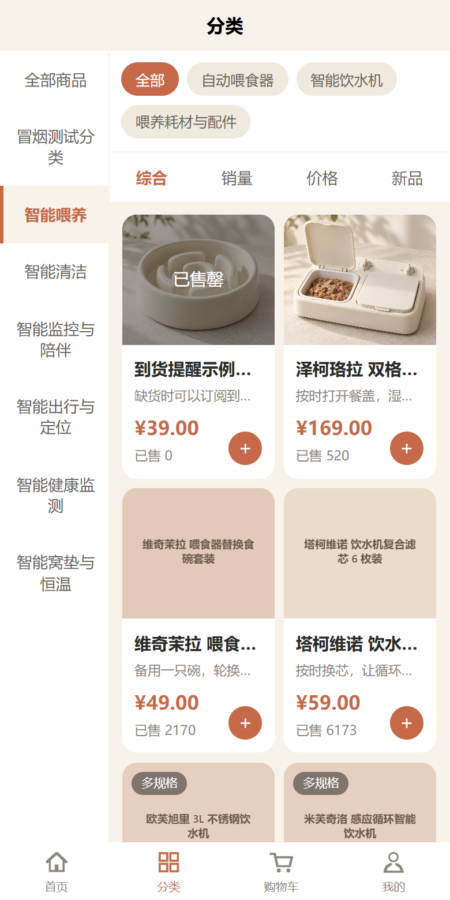
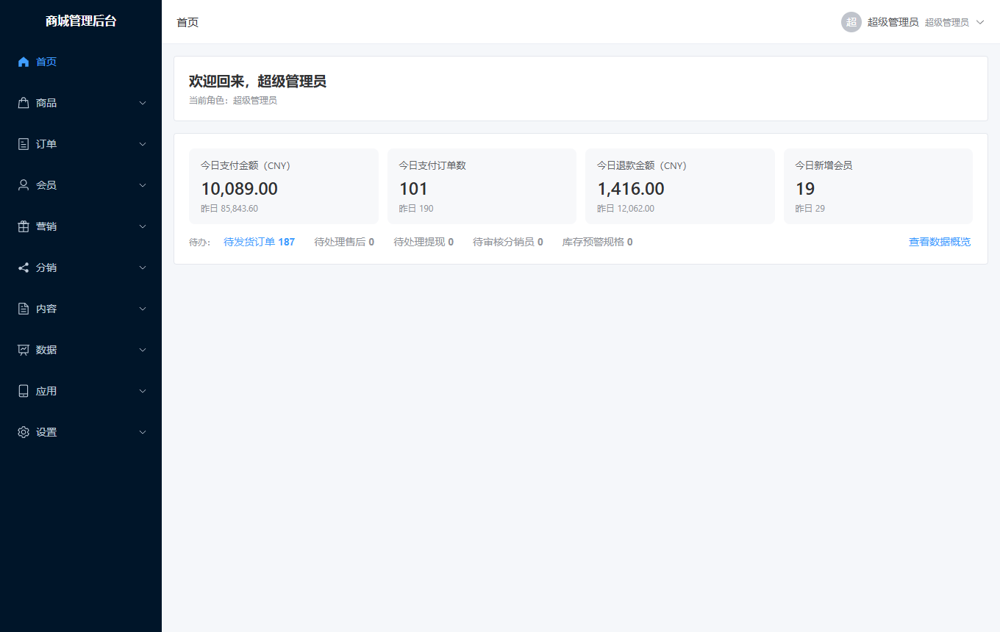
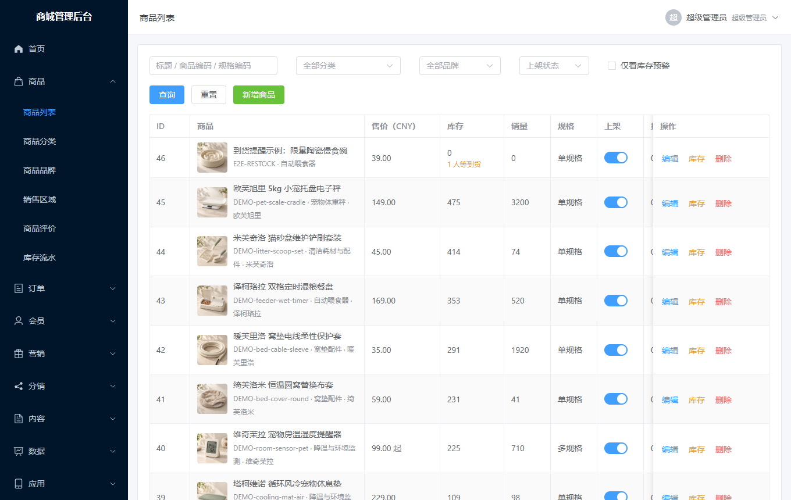

# 四海商城 SihaiMall

**简体中文** | [English](README.en.md)

[](https://github.com/henagyangedu/SiHaiMall/actions/workflows/ci.yml)
[](https://github.com/henagyangedu/SiHaiMall/releases)
[](LICENSE.md)

面向国内和出海两种场景的多语言分销商城，源码公开：一套后端，同时支撑管理后台、PC 网站、手机 H5 和微信小程序。支持多语言、多币种、按地区定价和收税、两级分销。

> **授权方式：非商业用途免费，商业用途需要取得商业授权。** 作者愿意把代码分享出来，同时希望用它经营的使用者付费支持后续的维护和开发。详见[授权说明](docs/授权说明.md)。

> **当前是开发版本。** 核心购物流程在本地经过了自动化测试和浏览器点击测试，但多数第三方对接（支付、短信、物流、登录）还没有用真实账号联调过，见下面的“对接状态”。用于生产前请自行完成联调和验收。

## 界面

| PC 端首页 | PC 端商品列表 |
| --- | --- |
|  |  |

| 手机端首页 | 手机端分类 | 
| --- | --- |
|  |  |

| 后台首页 | 后台商品列表 |
| --- | --- |
|  |  |

截图里的商品是自带的演示数据（宠物智能用品），可以一条命令导入或清除。

## 功能

**商品**
- 分类、品牌、多规格、分币种定价、按销售区域定价（国内到省市，境外到国家）
- 规格参数、配套商品、搭配套餐、商品评价和追评、收藏、到货提醒
- 关键词搜索、热门搜索词、搜索历史

**交易**
- 购物车、结算、下单、超时关闭、自动确认收货
- 运费模板（按件、重量、体积，按地区）
- 优惠券（满减、折扣）、会员折扣、积分抵扣、消费得积分
- 税费：按收货地区的价外税（销售税）和价内税（VAT）
- 售后：仅退款、退货退款、原路退回、商家代客发起
- 订单发票（登记式，不对接税控）、订单导出、小票打印

**会员与营销**
- 邮箱、手机号、微信小程序、Google 账号登录
- 会员等级与自动升级、积分、每日签到、余额
- 两级分销：邀请关系、佣金、结算、提现
- 站内信、邮件通知、后台群发消息

**国际化**
- 界面语言：简体中文、英语、西班牙语、法语、德语、日语、俄语
- 商品、分类、文章、协议等内容按语言维护，内置 AI 翻译（OpenAI、DeepSeek、Claude、通义千问）
- 多币种与汇率自动更新，订单固化下单时的币种和汇率
- 买家看到的时间按其所在时区显示
- 隐私合规：注册同意、自助注销、导出个人数据

**后台**
- 管理员、角色、菜单与按钮级权限
- 数据概览、趋势、商品排行
- 文章、公告、帮助中心、轮播图与广告位
- 支付、短信、存储、物流、电子面单、翻译等对接都在后台页面里配置，密钥加密保存
- 开放接口：给 ERP、财务、物流等外部系统读取订单、回传发货、同步库存、拉取支付流水，按应用发密钥、分权限

## 对接状态

下面这些已经写完并有自动化测试，但测试里第三方一侧是模拟的。**“未联调”表示没有用真实账号跑通过**，接口细节是按各家公开文档写的，第一次接入时可能需要调整。

| 类别 | 已对接 | 状态 |
| --- | --- | --- |
| 支付 | Stripe、PayPal、微信支付（小程序、H5、扫码、公众号内）、支付宝（手机网站、电脑网站） | 未联调 |
| 登录 | 微信小程序一键登录、Google 登录 | 未联调 |
| 短信 | GM 短信平台（验证码） | 未联调 |
| 物流查询 | 快递100（国内）、17TRACK（境外） | 未联调 |
| 电子面单 | 快递100 | 未联调 |
| AI 翻译 | OpenAI、DeepSeek、Claude、通义千问 | Claude、通义千问未联调 |
| 汇率 | Frankfurter、ExchangeRate-API（免费公开接口） | 可用 |
| 存储 | 本地存储、阿里云 OSS 等云存储 | 本地存储可用，云存储未联调 |

其他要知道的：
- 微信小程序只做过编译检查，没有在微信开发者工具或真机上跑过。
- 西、法、德、日、俄五种语言的译文由 AI 生成，没有经过母语人士校对。
- 还没有做 App 端、公众号网页授权登录、Apple 登录。

## 技术栈

| 部分 | 目录 | 技术 |
| --- | --- | --- |
| 后端接口 | `home/` | Laravel 13、PHP 8.4+、MySQL 8 |
| 管理后台 | `admin-web/` | Vue 3、Element Plus、Vite、Pinia |
| PC 网站 | `mall-pc/` | Vue 3、Element Plus、Vite |
| 手机 H5 / 小程序 | `mall-uni/` | uni-app（Vue 3，命令行工程，不依赖 HBuilderX） |
| 浏览器点击测试 | `e2e/` | Playwright（使用本机已安装的 Edge） |

后端采用 中间件 → 控制器 → 表单请求 → 服务 → 模型 的分层；金额一律用字符串和 bcmath 计算，不用浮点数。

## 快速开始（本地开发）

需要：PHP 8.4 以上（含 bcmath、openssl、pdo_mysql、mbstring、fileinfo 扩展）、Composer、MySQL 8、Node.js 20 以上。

```bash
# 1. 后端
cd home
composer install
cp .env.example .env          # 然后改里面的 DB_* 数据库配置
php artisan key:generate
php artisan migrate
php artisan db:seed           # 创建管理员 admin，密码只在终端显示这一次，请记下
php artisan mall:demo-import  # 可选：导入演示商品和内容
php artisan serve             # http://127.0.0.1:8000

# 2. 三个前端（各开一个终端）。它们默认把接口请求转发到 http://127.0.0.1:8000；
#    后端不在这个地址时，在各自目录建一个 .env.development.local，写上 VITE_API_PROXY=你的后端地址
cd admin-web && npm install && npm run dev      # 后台   http://127.0.0.1:5173
cd mall-pc   && npm install && npm run dev      # PC 端  http://127.0.0.1:5190
cd mall-uni  && npm install && npm run dev:h5   # 手机端 http://127.0.0.1:5180
```

本地用 `127.0.0.1` 访问前端时，在 `home/.env` 里加上 `UPLOADS_URL=/uploads` 和 `PAY_RETURN_HOSTS=127.0.0.1`。

部署到服务器见 [docs/部署说明.md](docs/部署说明.md)。

## 测试

```bash
# 后端：先建一个空库 gmmall_test，测试只会在库名以 _test 结尾的库上运行
cd home && php artisan test

# 界面文案：检查七种语言有没有漏的条目
cd mall-uni && npm run check:locale

# 浏览器点击测试：先启动三个前端，只能在开发库上跑
cd e2e && npm install && npm run all
```

## 文档

- [部署说明](docs/部署说明.md)
- [开放接口](docs/开放接口.md)：给 ERP、财务、物流系统对接用
- [授权说明](docs/授权说明.md)
- [更新日志](CHANGELOG.md)
- [演示数据格式](docs/演示数据格式.md)
- [开发说明](CLAUDE.md)：业务规则、各模块的设计取舍、已知的限制。改代码前建议先读相关章节。

## 参与开发

欢迎提 Issue 和 Pull Request，约定见 [CONTRIBUTING.md](CONTRIBUTING.md)。因为项目同时提供商业授权，提交代码前需要同意[贡献者协议](docs/贡献者协议.md)。

发现安全问题请不要公开提 Issue，见 [SECURITY.md](SECURITY.md)。

## 授权

本项目按 [PolyForm Noncommercial License 1.0.0](LICENSE.md) 授权：

- **个人学习、研究、非营利使用**：免费，可以修改和分发，保留 `LICENSE.md` 和 `NOTICE.md` 即可。
- **商业使用**（用它开店、在经营活动中使用、为客户搭建并收费等）：需要先取得商业授权。

怎么取得商业授权、什么算商业用途，见[授权说明](docs/授权说明.md)。商业授权的收入用于这个项目的维护和后续开发。
